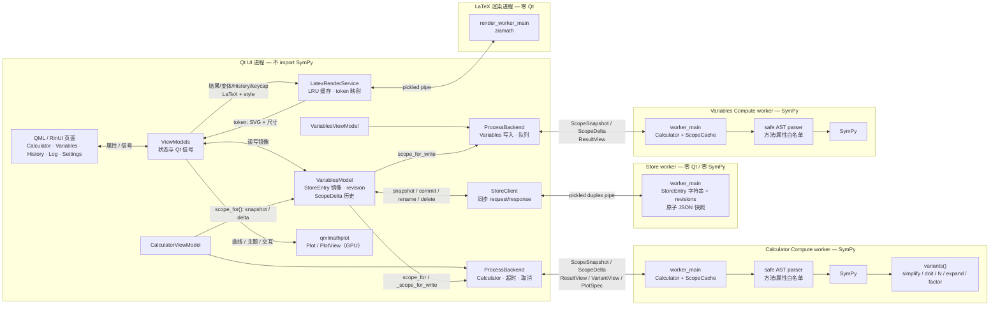
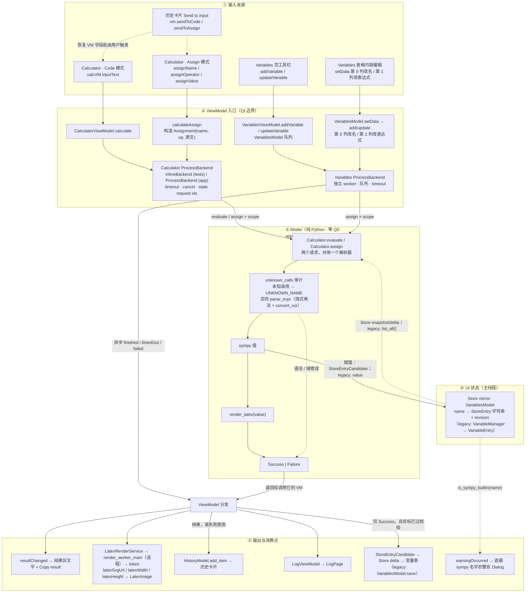
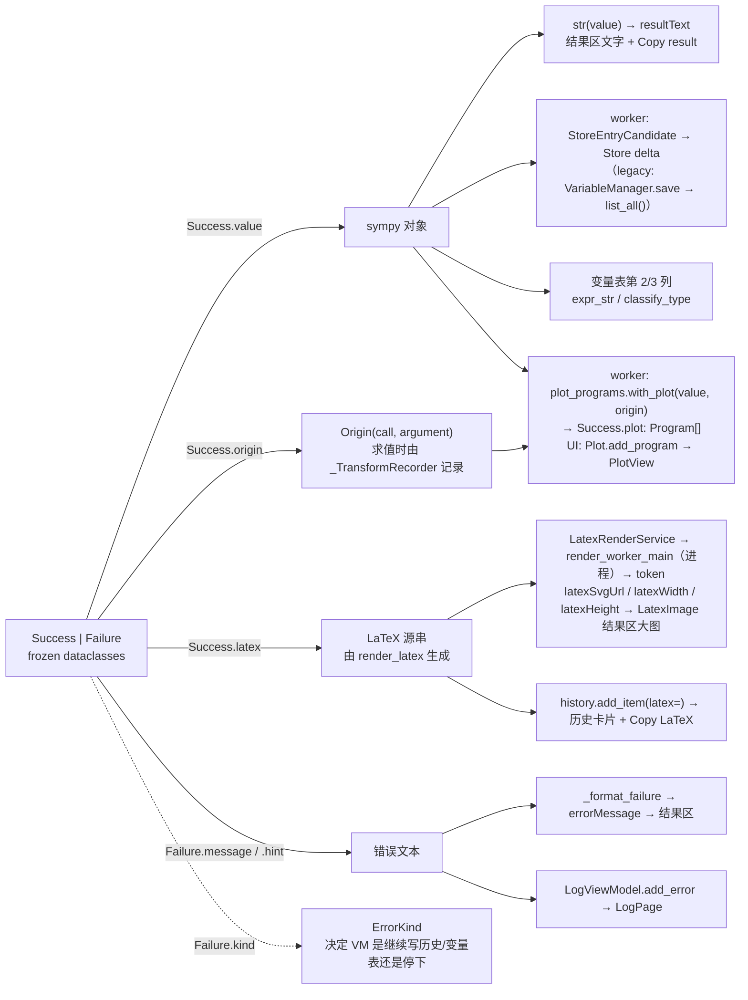

# Symplify Architecture — the calculation Model and its data flow

This page is **Model-first**: it documents the pure-Python calculation core
(`python/model/`), the two requests it answers, where those requests come from,
and who reads what comes back. It is about how data actually moves.

> **当前生产边界（重构后）**：UI 进程不 import SymPy。变量由 `StoreClient` →
> `store_worker` 持有字符串 `StoreEntry`；Calculator/Variables 的 scope 是
> `ScopeSnapshot`/`ScopeDelta`；`ProcessBackend` 跨进程只传 `ResultView` /
> `VariantView` / `PlotSpec`，SymPy 对象留在 Compute worker。本文的 Model 图仍以
> `Success | Failure` 描述模型内部语义，UI 侧的完整边界见
> `.Agent/DEVELOPER_GUIDE.md` 的 *Protocol DTOs* 与 *Calculation backend* 两节。

## The Model in one sentence

Two requests, one parser, no Qt:

```python
Calculator.evaluate(expression, scope)      -> Success | Failure   # read
Calculator.assign(Assignment(target, op, expression), scope) -> Success | Failure   # write
```

`Calculator` owns what an input *means* — which syntax is accepted, which names
resolve, what counts as a failure. Nothing above it may re-implement that, and
the Model decides nothing about display.

## 1. Data flow: sources in, sinks out

### 1.1 运行时执行域：主线程、渲染进程、worker 进程

这张图回答“代码在哪跑”，而不是“数据长什么样”。**生产路径**是：

- UI 主线程只持有 Qt/ViewModel 状态、Store 镜像和 DTO；
- `StoreClient` → Store worker 只保存字符串 `StoreEntry` 与 revision，**不 import Qt 或
  SymPy**；
- 两个独立的 `ProcessBackend` 各自启动 Compute worker（Calculator + SymPy +
  `ScopeCache`）：一个服务 Calculator，一个服务 Variables 页；Variables worker 只在第一次
  写入时启动，空闲 60 s 或离开页面且无写入时回收；
- LaTeX 结果/变体/History/keycap 共用 Renderer worker；Variables 详情仍可能在主线程同步
  渲染（短任务，受 `render_data_url` 的锁串行化）；
- 绘图计划由 Calculator worker 生成：`plot_programs.with_plot` 把 `plot_series` 转成
  qmlmathplot `Program`，UI 只做 `Plot.add_program`，不解析表达式。



生产路径的两个 worker 是有意分开的（B 方案）：变量编辑不必排在长计算后面，代价是变量
worker 活跃时出现第二份 SymPy/`ScopeCache`。Store 是唯一变量权威；Calculator 与
Variables 两个 worker 都只从 Store 的 snapshot/delta 重建自己的对象缓存。每个 Compute
请求还携带一个 `ParsePolicy`（Settings 的 calculation 开关），但它只影响新文本的解析；
Store 里的 `srepr` 是对象恢复格式，不受影响。测试/headless 仍可使用进程内
`Calculator` + `VariableManager` + `InlineBackend`，那不是生产路径。

### 1.2 逻辑数据流：Model 语义

> 这一张是**逻辑数据流**，不表示线程位置。实际执行域以 1.1 为准：`C1`–`C4` 在对应
> worker（Calculator 或 Variables）里运行；`C6`、输出和 Qt 对象在主线程；`B3`/`B4`
> 经 Variables 的独立 worker。



What the diagram is saying:

- **执行域看 1.1，数据语义看 1.2。** Calculator 的 Code/Assign 请求穿过
  `ProcessBackend`，在 worker 进程里调用 `Calculator`；Variables 页的 B3/B4 经
  Variables 的独立 worker（B6）；Calculator、Variables、History 和 keycap 的
  LaTeX SVG 由独立渲染进程生成。
- **Four UI routes, two model requests.** Code mode, Assign mode, the Variables
  toolbar and the table's inline edit all end in `evaluate` (read) or `assign`
  (write); no route assembles an expression string of its own any more.
- **The Calculator page's two routes cross a backend boundary.** `calculate` /
  `calculateAssign` submit `(kind, payload, scope)` to a `CalculationBackend`
  and return; the `Success | Failure` arrives later as a Qt signal. The default
  backend is synchronous (tests/headless); the app uses a spawned
  `ProcessBackend` with a hard timeout, so a runaway sympy call is terminated
  instead of freezing the event loop. The VM allocates request ids, ignores
  replies for cancelled requests, and cancels the previous request when a new
  one is submitted or the result is cleared. **The result is sent before the
  optional work**: the backend computes `simplify` / `doit` / `N` / `expand` /
  `factor` in the same deadline but delivers those rows later on
  `variantsReady`, so the answer text does not wait for them. The UI requests
  their LaTeX from an isolated renderer process; the result and variant images
  arrive by token. History uses the same process and cache. Timeouts become `Failure(ErrorKind.TIMEOUT)` and are recorded like any
  other failure; the result header shows the backend status. The Variables
  page's own routes (B3/B4) cross a second backend (B6): `VariablesModel` queues
  one `assign` at a time, applies the answer when it arrives, and
  `variableAdded(name, ok)` drives the page's selection. The in-process
  `Calculator` remains only for tests/headless.
- **`scope` is the second input channel.** The production path passes a Store
  `ScopeSnapshot`/`ScopeDelta`; valid entries only, so saved variables resolve as
  symbols and names that resolve to nothing stay symbolic. The headless/legacy
  path hands `VariableManager.list_all()` to `parse_expr` as `local_dict`.
- **The write path is validated before anything happens.** `assign` rejects a bad
  target or a missing augmented-assignment target *before* evaluating, so a
  rejected write cannot leave a variable or a success log line behind. What it
  *does* leave is an error card in the history — marked as an error, never as a
  result — because the input is what the user needs in order to fix it.
- **The write result is string-only in production.** The worker returns a
  `StoreEntryCandidate`; the UI commits it to the Store, and the next request
  reads the resulting snapshot/delta. In the headless/legacy path the value is
  stored as a `VariableEntry` and read back through `list_all()`. In both cases
  the value is passed through `sympy.simplify` before it leaves the model
  (`_simplified`), so the store and the next evaluation see the simplified form;
  lists (`solve`'s roots) are exempt, and the plot's `origin` is recorded before
  the pass.
- **Text and LaTeX are terminal.** `str(value)` feeds the result line and the
  clipboard; the LaTeX source feeds the rendered image and the history entry
  (which re-renders lazily on its own).
- **A plot is the third sink, and it needs provenance.** `plotting.plot_series`
  reads the result's free symbols (`x` → `y = f(x)`, `x` and `y` → the level set
  `F = 0`, anything else → nothing to draw) and, when `Success.origin` says the
  request *was* a transform call, what that call was applied to: `diff` and
  `integrate` draw the function beside the result, `solve` draws the expression it
  solved. `origin` is recorded while the parser runs (a wrapper in its
  `local_dict`), never by re-parsing the text — the model has no parser of its
  own, by design. The **worker** then turns each Series into a qmlmathplot
  `Program` (`plot_programs.with_plot`) and stores the plain specs in
  `Success.plot`; the UI only calls `Plot.add_program(program)`. The UI does not
  parse for the plot and does not import SymPy's plotting side.
- **Failures are history too.** A failed request is recorded with its input
  (name/op/expression for assignments) and the failure text, so the card can
  show the reason and *Send to input* can put the expression back to be fixed.
  The `error` role is what makes a card render as an error card.

## 2. What comes back: `Success` or `Failure`



| Shape | Fields | Read by |
|---|---|---|
| `Success` | `expression`, `value`, `latex`, `origin` | `value` → the result line, the variable store, the next evaluation and the plot; `latex` → the result image and the history card; `origin` → what the plot draws beside the result (the function a derivative came from); `expression` → provenance |
| `Failure` | `expression`, `kind`, `message`, `hint` | `message` + `hint` → the result area, the log and the history card; `kind` → which follow-up writes are allowed |

Both are frozen dataclasses, so a caller cannot half-fill a result. The old
`CalculationResult` flag-and-payload struct is gone, and with it the members
nothing ever read (`result_type`, `metadata`, `__str__`, the `displayText`
property, `VariableManager.revision`, `VariablesModel.InvalidRole`).

### Error kinds

| Kind | Meaning |
|---|---|
| `SYNTAX` | the text is not parseable as an expression |
| `UNKNOWN_NAME` | a name used as a call that resolves to no function, or an augmented assignment whose target does not exist |
| `INVALID_NAME` | an assignment target that is not a legal variable name |
| `UNSUPPORTED` | a well-formed request the model does not implement (e.g. `**=`) |
| `INTERNAL` | sympy raised a domain error — never the user's typo |

Every kind is produced somewhere; none is declared speculatively.

## 3. The language rules the Model enforces

**Unknown calls are reported, not rewritten.** `implicit_multiplication` cannot
tell a call from juxtaposition, so it silently turns `bar(2)` into `2*bar`.
`Calculator.unknown_calls` audits the text first and returns `UNKNOWN_NAME` with
a `difflib` suggestion (`sovle(…)` → "did you mean 'solve'?"). Names that *are*
in `scope` are exempt: `f(x)` with `f` a value stays multiplication, which is the
documented meaning of juxtaposition.

**Permissions are otherwise deliberately indulged** (and locked by tests):
unknown *symbols* stay symbolic, `2x` and `x^2` work, `Matrix(...)` is reachable,
and a variable may shadow a sympy name — `sin = 5` makes `sin(x)` mean `5*x`.
That last one is a choice, not an accident; `is_sympy_builtin` warns about it
instead of refusing it.

**Names have one definition.** `validate_name` and `is_sympy_name` are module
functions in `variable.py` used by both the store and the request layer, so the
UI and the Model cannot disagree about what a legal or reserved name is.

## 4. `Assignment`: the only write path

```python
Assignment(target="y", op="+=", expression="2y")
```

- `expression` stays **text**, so the expression language is parsed by exactly
  one parser. The previous implementation rebuilt the write as the string
  `f"{name} {op[0]} ({value})"`, which turned `x += 1` on an undefined `x` into
  the self-referential binding `x = x + 1`.
- Augmented operators (`+= -= *= /= %=`) require the target to exist
  (`UNKNOWN_NAME` otherwise) and combine the stored value with the parsed
  right-hand side — node to node, never text to text.
- The target is validated *first*, which is why an invalid name now produces
  nothing at all instead of "success in the history, absent in the table".

## 5. Store entries and the legacy `VariableManager`

The production Store stores **strings**, not objects: `name`, `srepr`, `display`,
`type_label`, `latex`, `revision`, `valid` (`StoreEntry`). A snapshot/delta is
what the Compute worker restores into its `ScopeCache`; the Store itself never
imports SymPy. The `VariableManager` below is the in-process/headless fallback
kept for tests and the legacy backend.

- Entries are **snapshots**: an assignment stores the sympy object it evaluated
  to at that moment. Nothing is re-evaluated when the sources of an expression
  change, and there is no dependency tracking.
- A failed *value* is kept as an **invalid (NaN) entry** (`save_invalid`) so the
  user's raw input — and its row — survives; `list_all()` excludes those entries.
  A failed *name* is not stored at all.
- `classify_type` gives the table's third column (`Integer`, `Matrix`,
  `Invalid`, …); `VariableEntry.expr_str` gives the second.
- `rename` rebuilds the store in order, so a rename keeps the entry's position
  and the table's row order never disagrees with the store's.

## 6. Boundary rule and how to check it

**`python/model/*` never imports Qt.** Every call from the UI crosses a
ViewModel first, and every result comes back as plain data. `main.py` is the
composition root: it creates the Store worker, the two `ProcessBackend`s, and
`MainViewModel`, then registers the viewmodels as flat QML context properties.
The in-process `Calculator`/`VariableManager` are created only when the
composition root omits `store_client` (tests/headless).

The behaviour contract is locked by tests (no framework needed):

```bash
uv run python -m tests.test_model      # model + viewmodels, ~3s
```

They cover the expression language, the error kinds, the assignment rules, the
name tables and the ViewModel invariants (a rejected write leaves nothing
behind). Run them before and after touching the parser or the write path.

## Where settings live (outside the Model)

The Model never sees a settings file. Appearance, rendering and window geometry are
owned by `python/settings.py` (location + YAML + validation) and
`SettingsViewModel`, and RinUI's own theme/backdrop persistence is taken over by
`python/rinui_bootstrap.py` — see "Settings & config" in the developer guide. The
only setting the Model touches is the LaTeX font size, which the viewmodels pass to
`latex_to_svg(size=...)` when they render.
